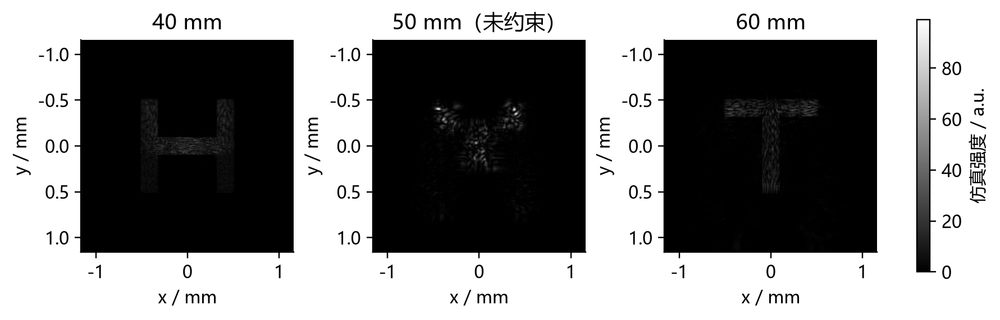

# 计算全息显示实验 · Computational Holography Lab

视觉科学与 3D 显示技术实验的 MATLAB 项目：从二维 Gerchberg–Saxton（GS）相位恢复出发，实现单深度、双平面重建，比较随机复振幅编码，并以固定评价函数搜索双平面生成权重。



## 实验完成情况

| 内容 | 已有结果与范围 |
| --- | --- |
| 二维 H 与图片 GS | 数值仿真；实验报告记录了 H、苹果 Logo 的实物重建 |
| 单深度／双平面 GS | 角谱传播仿真；双平面已尝试上机，但未清晰观察到预期双深度图像 |
| 随机复振幅编码 | 零／随机目标相位、有限孔径、单帧／10 帧强度平均的数值对照 |
| 双平面权重搜索 | 固定初相、迭代预算与评分，粗搜加局部细搜；属于离散候选搜索 |

现场使用 **532 nm** 激光；已有深度仿真采用 **633 nm**。SLM 波长 LUT 标定状态未记录，因此 PNG 格式正确不代表已完成器件标定或双平面实物验证。

## 环境与快速开始

- MATLAB R2023b（本次整理的验证环境）。未验证其他版本或 GNU Octave。
- `gs_image_demo` 需要 Image Processing Toolbox（`imresize`、`im2double` 等），并会弹出图片选择窗口。
- 完整深度仿真使用大型复数数组，需数 GB 可用内存；完整权重搜索明显慢于快速测试。

在 MATLAB 中将当前文件夹切换到仓库根目录，然后执行：

```matlab
addpath('src', 'tests');
test_weight_search;       % 小网格数值回归测试
test_result_dir;          % 输出路径与唯一性检查
test_demo_exports;        % 五个非交互演示的两轮迭代导出检查
gs_demo;                 % 完整二维 H：200 次迭代
```

后续按下表运行所需脚本。演示脚本会清空工作区并关闭已有图窗，请先保存工作。

| 入口（位于 `src/`） | 内容 | 默认参数／输出 |
| --- | --- | --- |
| `gs_demo` | 二维 H 的傅里叶 GS | 1080×1920，200 次；PNG、CSV、MAT |
| `gs_image_demo` | 自选图片的傅里叶 GS | 1080×1920，100 次；图片等比例居中 |
| `gs_depth_demo` | 单深度角谱 GS | 50 mm，80 次；原生画布相位 PNG |
| `gs_two_depth_demo` | 等权双平面 GS | H：40 mm；T：60 mm；100 次 |
| `gs_two_depth_weighted` | 固定加权双平面 GS | H:T = 0.75:0.25；100 次；保存选中迭代 |
| `gs_weight_search` | 双平面生成权重搜索 | 粗步长 0.1，局部步长 0.025；每候选 100 次；CSV、MAT |
| `random_two_depth_demo` | 先叠加目标复场，再随机编码为纯相位 | 默认零目标相位；512×512 有效区 PNG、对照图、CSV、MAT |

`random_two_depth_demo.m` 中把 `target_phase_mode` 从 `'zero'` 改为 `'random'`，可运行另一组目标相位对照。它不执行 GS 迭代，平均的是传播后的强度。

每次运行在 `results/<实验名>/<唯一子目录>/` 保存新结果，命令行打印完整路径。运行产物已被 Git 忽略。`gs_weight_search` 保存原始复光场，不直接导出 Full-HD PNG；应在确认器件参数后从原始相位生成加载图。

## 目录

```text
src/          MATLAB 演示、评分函数、权重优化和输出路径辅助函数
tests/        小网格回归测试、输出路径测试和短迭代导出检查
docs/         完整实验报告、算法原理、随机编码分析与复现说明
docs/assets/  原报告的数值图与实验照片
examples/     原实验的代表性 PNG 和 CSV（历史结果）
results/      本地新生成的输出（不上传）
```

## 参数与指标

深度 GS 的计算网格为 1536×2560，中央 256×256 像素均匀照明，中心裁取 1080×1920 输出；像素间距 8 μm。随机编码使用 1536×1536 计算网格和 512×512 照明孔径。**零相位不会使像素关闭**，外围无光必须由真实照明或光阑实现。

二维／固定加权演示使用总能量归一化强度 RMSE；权重搜索使用相对 L2 误差并取两层较大值作为评分。随机编码另用 ROI 内最优比例拟合的形状误差、能量占比等指标，不能将这些分数直接混合比较。

原始权重搜索 CSV 的最佳已测候选为 **H:T = 0.70:0.30**，第 **98** 次迭代，**J = 0.5703335705**。这不是全局最优证明，也不是本次整理重新进行完整搜索的结果。详见 [结果来源与复现说明](docs/reproducibility.md)。

## 文档与参考

- [完整实验报告](docs/lab-report.md)：现场条件、数值结果、误差分析及代码说明。
- [实验原理与核心算法](docs/principles.md)。
- [随机复振幅编码双平面分析](docs/random-encoding.md)。
- [相位导出、结果来源与验证](docs/reproducibility.md)。
- Gerchberg & Saxton, *Optik* 35, 237–246 (1972).
- Martínez Fuentes & Moreno, *Optics Express* 26, 5875–5893 (2018). [DOI: 10.1364/OE.26.005875](https://doi.org/10.1364/OE.26.005875).

本仓库未附加开源许可证；论文、厂商资料、课件 PDF、原报告 DOCX、备份和大型 MAT 数据不随仓库收录。实验照片与历史结果来自原实验目录。
