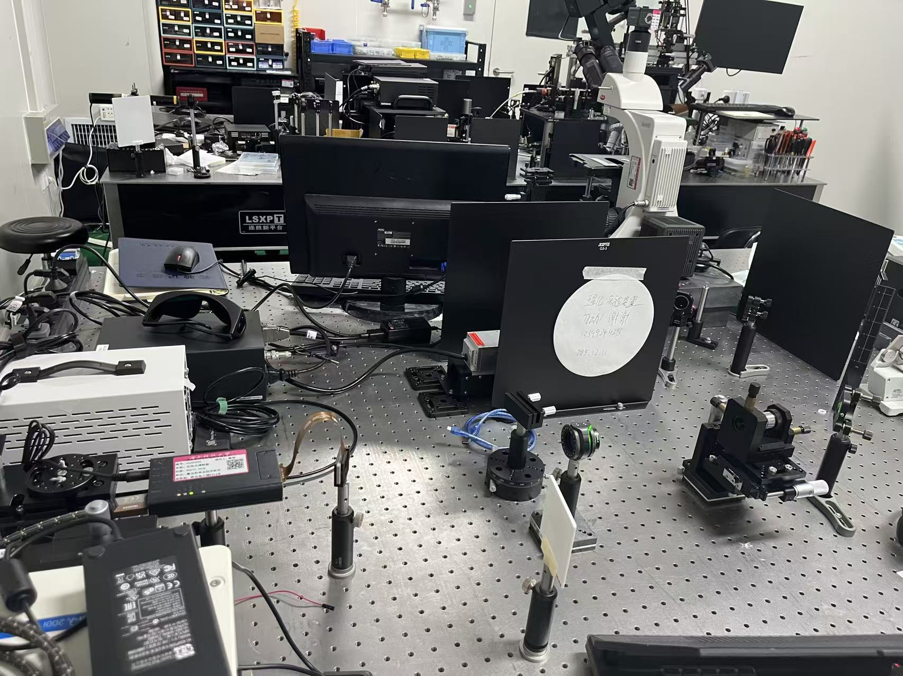
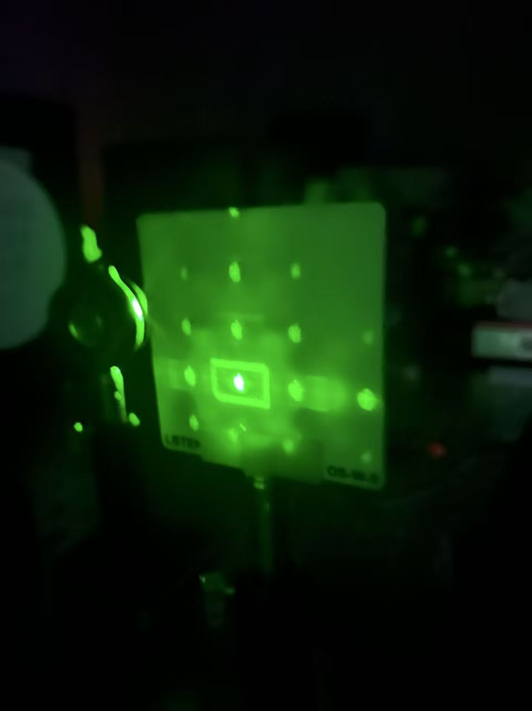
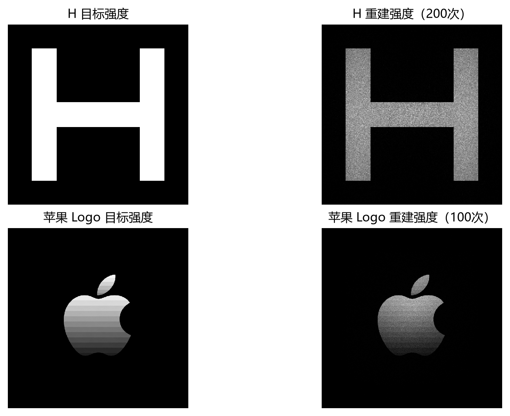
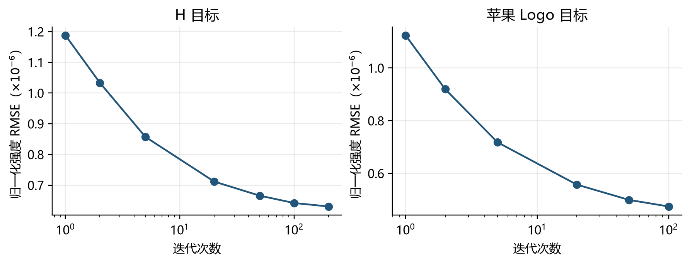
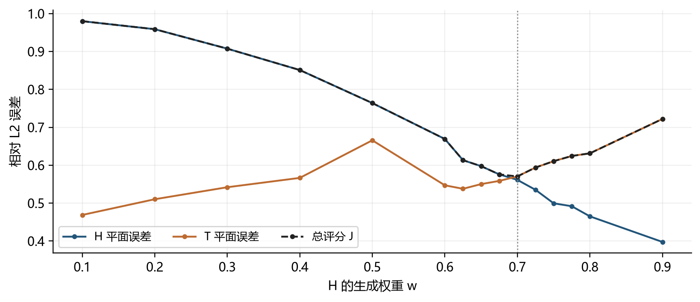
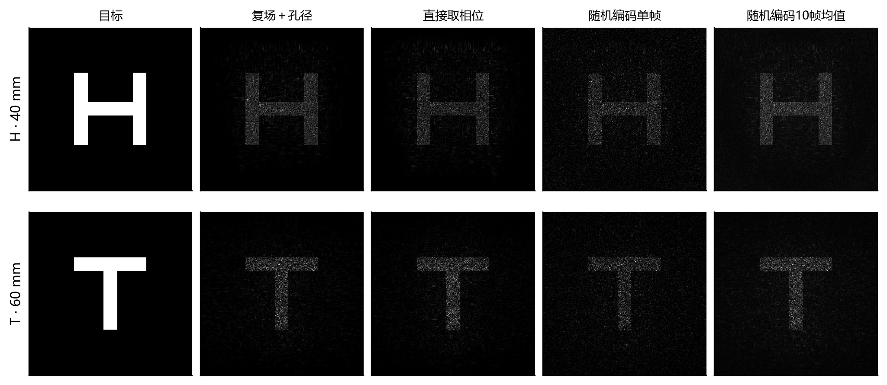
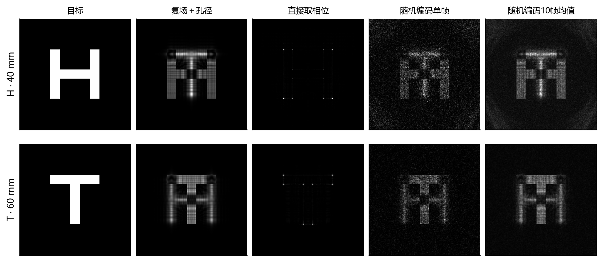

# 计算全息显示实验报告

课程名称：视觉科学与3D显示技术　　指导老师：高辉

专业：________　班级：________　姓名：________　学号：________

实验日期：________　实验地点：________

## 一、实验目的和要求

本实验以纯相位空间光调制器为显示器件，研究由目标强度分布求解相位全息图的方法，并比较数值传播与实际光学重建的差异。实验从二维图像重建出发，扩展到两个离散深度的全息成像，再通过随机复振幅编码和权重搜索探索算法改进。

（1）理解计算全息与纯相位调制的基本关系，掌握目标强度、目标振幅、复光场及相位灰度图之间的转换，理解 GS 算法中往返传播和交替振幅约束的作用。

（2）使用 MATLAB 计算字母 H 和苹果 Logo 对应的相位全息图，将其加载到 SLM，并在光屏上观察二维重建图像及灰度变化。

（3）利用角谱传播建立双平面 GS 模型，在 40 mm 与 60 mm 两个设计距离分别设置 H 与 T；比较等权和加权更新，并以统一指标搜索合适权重。

（4）研究基于随机互补掩膜的纯相位复振幅编码，比较目标相位、有限孔径、单帧编码和多帧强度平均对双平面重建的影响。

（5）记录真实实验条件，分析仿真波长、有效照明、SLM 画布与相位标定对重建效果的影响。本次二维 H 和苹果 Logo 已完成实物重建；GS 双平面完成了上机尝试，但未清晰观察到预期的双深度图像；随机掩膜双平面仅完成数值仿真。

## 二、实验内容和原理（以及核心算法介绍）

纯相位 SLM 在给定照明下调节各像素的出射相位，目标强度由光场传播后的相干叠加形成。以下依次介绍 GS、随机掩膜编码及它们在二维和双平面设计中的应用，再说明权重搜索。双平面的距离和数值参数属于仿真模型；真实上机条件与观察结果见第三、四部分。

### 2.1 GS 算法的基本原理

GS 算法是一种通过往返传播和交替施加振幅约束来求解相位的迭代算法。在本实验中，SLM 面的入射振幅由照明条件确定，目标面的振幅由期望图像确定，而两个平面的相位未知。算法在两个平面之间反复传播，每次保留当前计算得到的相位，将振幅替换为对应平面的规定振幅，从而寻找同时近似满足两面要求的相位分布。

对于理想纯相位 SLM，出射光场表示为：

$$
U_0(x,y)=A_0(x,y)\exp[i\phi(x,y)].
$$

其中，A₀ 表示已知的入射振幅及照明孔径，φ 为需要计算并加载到 SLM 上的相位。相位调制通过改变各像素出射光的相对相位，控制这些光在观察面上的干涉，从而形成目标强度分布。若目标图像规定的是强度 Iₜ，则用于约束的目标振幅应为：

$$
A_t(x,y)=\sqrt{I_t(x,y)}.
$$

必要时再乘以整体归一化系数，使目标振幅与输入光场的能量尺度一致。由于光强与振幅模的平方成正比，灰度目标不能直接作为振幅使用，否则重建目标的灰度关系会被改变。

以传播算子 P 表示 SLM 面到目标面的传播，并以 n 表示迭代序号。一次 GS 迭代首先将当前 SLM 光场传播到目标面：

$$
V^{(n)}=\mathcal P[U_0^{(n)}].
$$

随后保留目标面相位，将振幅替换为期望目标振幅：

$$
\widetilde V^{(n)}=A_t\exp[i\arg V^{(n)}].
$$

将约束后的目标光场反向传播回 SLM 面：

$$
B^{(n)}=\mathcal P^{-1}[\widetilde V^{(n)}].
$$

最后恢复 SLM 面的已知振幅，仅保留反传光场的相位：

$$
U_0^{(n+1)}=A_0\exp[i\arg B^{(n)}].
$$

上述过程使相位逐步适应两个平面的振幅要求。迭代达到设定次数，或根据评价指标选出合适的迭代结果后，提取 SLM 面相位作为相位全息图。GS 算法中的随机初相用于提供迭代起点，与后述随机掩膜编码是两种不同操作。由于纯相位约束及目标强度约束构成非凸问题，有限次迭代通常得到近似解，结果会受到初始相位、目标图案及传播条件影响。

### 2.2 随机掩膜算法的基本原理

随机掩膜方法利用像素的随机空间分配，保留全息光场中的有效信息。全息图中的一个像素通常会对重建面的许多位置产生贡献，因此随机选取一部分全息像素并不等于删除目标图像中相同比例的像素。

先考虑能够真正关闭未选像素的理想振幅遮挡模型。设二值掩膜 R 在每个像素处以概率 p 取 1，并将其写为均值与随机扰动之和：

$$
R=p+\delta R,\qquad \mathbb E[\delta R]=0.
$$

利用光场传播的线性性质，可以得到：

$$
\mathcal P[RU]=p\mathcal P[U]+\mathcal P[\delta R\,U].
$$

第一项保留原重建光场的结构，其振幅缩小为原来的 p 倍；第二项为随机抽样引入的附加光场。因此，相干信号项的强度按 p² 缩放，但总重建强度还包含随机光场及干涉项，不能将随机抽样简单理解为“图像仅变暗而完全不变”。

纯相位 SLM 不能通过将相位设为零来关闭像素，因为零相位对应的复透射因子仍为 1。为在纯相位器件上保留复光场的振幅信息，本实验采用随机互补掩膜编码：按照所需振幅的大小，随机选择目标相位或用于将光引向外围的发散相位。

将待编码的复振幅归一化为：

$$
T(x,y)=A(x,y)\exp[i\varphi(x,y)],\qquad 0\leq A(x,y)\leq 1.
$$

在照明区域内，为每个像素生成独立的均匀随机数 ξ，按目标振幅建立二值掩膜：

$$
\xi(x,y)\sim\mathcal U[0,1),\qquad R(x,y)=\mathbf 1_{\{\xi(x,y)<A(x,y)\}}.
$$

其中，指示函数在条件成立时取 1，否则取 0。因此，目标相位被选中的概率等于目标振幅 A，而不是目标强度 A²。设目标相位函数与发散相位函数分别为：

$$
F=\exp(i\varphi),\qquad D=\exp(i\psi).
$$

若 Pₐ 为照明区域内取 1、外围取 0 的孔径函数，则编码后的 SLM 光场为：

$$
M=P_a[RF+(1-R)D].
$$

由于 R 只能取 0 或 1，每个被照明像素只加载两种相位之一，其振幅始终为 1，满足纯相位调制条件。所需相位可写为：

$$
\theta=\operatorname{mod}[R\varphi+(1-R)\psi,2\pi].
$$

利用掩膜的统计平均值等于 A，可将编码光场分解为：

$$
M=P_aAF+P_a(1-A)D+P_a(R-A)(F-D).
$$

三项分别代表所需复光场、经发散相位调制的剩余光场以及随机编码误差。该方法的作用是通过空间概率分配编码振幅信息，并尽量将剩余光引离观察区域；其重建仍会受到背景和随机噪声影响，不能认为编码后的光场严格等于原复光场。

本实验使用径向线性相位作为发散相位：

$$
\psi(x,y)=\operatorname{mod}\!\left(2\pi f_a\sqrt{x^2+y^2},2\pi\right).
$$

其中，fₐ 为径向空间频率。按照本实验的传播符号约定，正的径向相位梯度使光倾向于向外围传播。在近轴条件下，偏转角近似满足：

$$
\vartheta\approx\lambda f_a.
$$

脚本采用的径向空间频率为 40000 m⁻¹，低于 8 μm 像素间距对应的奈奎斯特频率 62500 m⁻¹。发散相位对剩余光的重分布还受到孔径及衍射影响，是否能充分避开目标区域需要通过实际传播计算判断。

### 2.3 利用 GS 算法实现夫琅禾费成像与双平面成像

#### 2.3.1 远场夫琅禾费成像

在满足夫琅禾费近似时，观察面复光场与孔径面复光场的二维傅里叶变换对应。设传播距离为 z，观察面坐标为 ξ、η，波数为 k，则：

$$
U_z(\xi,\eta)\approx\frac{e^{ikz}}{i\lambda z}\exp\!\left[\frac{ik}{2z}(\xi^2+\eta^2)\right]\mathcal F\{U_0\}\!\left(\frac{\xi}{\lambda z},\frac{\eta}{\lambda z}\right).
$$

其中，波数为：

$$
k=\frac{2\pi}{\lambda}.
$$

因此，忽略整体强度比例后，观察面的强度由傅里叶变换的模平方确定。对于特征孔径尺度 D₀，自由空间远场近似要求孔径的菲涅耳数足够小：

$$
N_F=\frac{D_0^2}{\lambda z}\ll 1.
$$

实验中也可以利用傅里叶透镜，在其后焦面获得与入射光场傅里叶频谱对应的强度分布。此时位置与空间频率的尺度关系由透镜焦距决定。

二维脚本 `gs_demo.m` 与 `gs_image_demo.m` 分别用于简单图案和输入图片的重建，其中 `gs_image_demo.m` 将图像转换为灰度、等比例缩放并居中放置在 1080 行、1920 列的画布上，再对目标强度开平方得到目标振幅。算法以随机相位初始化目标面光场，在目标面施加振幅约束后，通过逆傅里叶变换计算 SLM 面复光场：

$$
B^{(n)}=\operatorname{ifft2}\!\left(\operatorname{ifftshift}\!\left[A_t\exp(i\arg V^{(n)})\right]\right).
$$

均匀照明的纯相位约束将 SLM 面振幅置为 1：

$$
U_0^{(n+1)}=\exp[i\arg B^{(n)}].
$$

随后通过正向傅里叶变换得到新的目标面光场：

$$
V^{(n+1)}=\operatorname{fftshift}\!\left(\operatorname{fft2}[U_0^{(n+1)}]\right).
$$

其中，`fftshift` 将零空间频率移到图像中心，`ifftshift` 用于反变换前恢复正确的频率排列。图片脚本 `gs_image_demo.m` 重复上述过程 100 次，并记录第 1、2、5、20、50、100 次迭代的重建强度，用于观察迭代对重建效果的影响；当前字母 H 脚本 `gs_demo.m` 则迭代至 200 次，并增加第 200 次的记录。此类脚本计算的是离散傅里叶域图像，实际图像尺寸还取决于波长、像素间距、传播距离或透镜焦距。

#### 2.3.2 有限距离双平面成像

双平面重建要求同一张 SLM 相位全息图在两个不同距离处形成不同目标。脚本 `gs_two_depth_demo.m` 将 H 设置在 40 mm 处、T 设置在 60 mm 处，并使用角谱法描述自由空间传播。该方法通过不同空间频率分量积累的传播相位，计算任意指定距离上的复光场。

角谱传播算子定义为：

$$
\mathcal P_z[U]=\mathcal F^{-1}\!\left\{\mathcal F[U]H_z(f_x,f_y)\right\}.
$$

传播传递函数为：

$$
H_z(f_x,f_y)=\exp\!\left[i2\pi z\sqrt{\lambda^{-2}-f_x^2-f_y^2}\right].
$$

其中，fₓ、fᵧ 为横向空间频率。脚本验证当前采样范围内仅包含传播波，因此传递函数的模为 1，反向传播可通过其复共轭实现：

$$
H_{-z}=H_z^*.
$$

深度 GS 脚本采用 633 nm 波长、8 μm 像素间距和 1536 行、2560 列的计算网格，中央 256×256 像素区域均匀照明，外围留白用于减轻 FFT 周期边界引起的回绕影响。输出相位时中心裁取 1080×1920 像素画布。这里的外围无光属于入射照明假设，不能通过给外围像素设置零相位来实现。

设两个目标平面的序号分别为 H、T。为使目标约束与输入光场具有相同离散总能量，先计算：

$$
E_0=\sum_{x,y}A_0^2(x,y).
$$

两个平面的目标振幅分别归一化为：

$$
A_p(x,y)=\sqrt{\frac{E_0I_p^{\mathrm{tar}}(x,y)}{\sum_{x,y}I_p^{\mathrm{tar}}(x,y)}},\qquad p\in\{H,T\}.
$$

两个目标面是同一束光依次经过的不同截面，因此各面的总能量分别与输入能量对应，不需要将输入能量平均分给两个深度。

每次迭代中，从同一个当前 SLM 光场出发，分别传播到两个目标面：

$$
V_p^{(n)}=\mathcal P_{z_p}[U_0^{(n)}].
$$

在每个目标面替换振幅，并保留当前相位后反向传播：

$$
B_p^{(n)}=\mathcal P_{-z_p}\!\left[A_p\exp(i\arg V_p^{(n)})\right].
$$

等权算法将两个反传复光场平均，再施加 SLM 面振幅约束：

$$
U_0^{(n+1)}=A_0\exp\!\left[i\arg\!\left(\frac{B_H^{(n)}+B_T^{(n)}}{2}\right)\right].
$$

这里平均的是包含振幅和相位的复光场，而不是直接平均两张相位图。两个反传光场共同决定新的 SLM 相位，使同一张全息图逐步兼顾两个深度的成像要求。正实数的整体缩放不会改变相位，因此除以 2 本身不影响最终相位，关键在于两个反传光场的相对贡献。

脚本对更新后的同一张全息图计算两层重建误差，并保留两层归一化强度 RMSE 平均值最低的一轮。最终固定该全息图，观察 40、50、60 mm 三个截面的强度分布。40 mm 和 60 mm 为指定目标面，50 mm 为未施加目标约束的观察面，用于展示传播过程中图像随深度的变化。这构成了两个离散深度层面的显示，不能据此认为任意中间深度也都满足预设图像。

### 2.4 利用随机掩膜算法实现双平面成像

`random_two_depth_demo.m` 采用非迭代的复场设计与随机纯相位编码流程：先分别构造两个目标面的复光场，反向传播到同一个 SLM 面并叠加，再将叠加复场编码为纯相位全息图。

首先将两个目标的离散总能量归一化为 1，并指定目标相位：

$$
U_p^{\mathrm{tar}}=\sqrt{\frac{I_p^{\mathrm{tar}}}{\sum_{x,y}I_p^{\mathrm{tar}}}}\exp(i\alpha_p),\qquad p\in\{H,T\}.
$$

其中，αₚ 可以取零，也可以在目标亮像素上取均匀随机相位。两种设定具有相同的目标强度，但反向传播后的复场分布以及另一深度处的离焦光场不同，因此会影响孔径截断损失和层间串扰。当前脚本设为零目标相位，并保留了随机目标相位的对照设置。目标相位一旦确定，在后续多次编码中保持不变。

然后将两个目标分别反传至 SLM 面：

$$
V_H=\mathcal P_{-z_H}[U_H^{\mathrm{tar}}],\qquad V_T=\mathcal P_{-z_T}[U_T^{\mathrm{tar}}].
$$

将两个反传光场按复振幅叠加：

$$
V=b_HV_H+b_TV_T.
$$

当前脚本的两个复振幅权重均为 1。与多平面 GS 不同，此处只执行一次反传叠加，没有再通过迭代使两个目标约束反复协调。

忽略孔径截断与编码误差时，将叠加光场传播到 H 平面，可得：

$$
\mathcal P_{z_H}[V]=b_HU_H^{\mathrm{tar}}+b_T\mathcal P_{z_H-z_T}[U_T^{\mathrm{tar}}].
$$

第一项为期望 H 光场，第二项为 T 光场传播到该位置后的离焦项。类似地，在 T 平面存在来自 H 的离焦项。因而，双平面复场中已经包含层间串扰；实际强度还包含两个光场之间的相干干涉。随机编码能近似保留设计复场的信息，但不会自动消除设计复场本身已有的串扰。

随后考虑有限照明孔径，并对振幅归一化：

$$
A_{\max}=\max_{P_a=1}|V|,\qquad T=P_a\frac{V}{A_{\max}}.
$$

提取编码所需的振幅和相位：

$$
A=|T|,\qquad \varphi=\arg V.
$$

在照明区域内，A 位于 0 到 1 之间。依照前述随机掩膜编码方法，以 A 为概率选用目标相位，否则选用发散相位，得到单张随机纯相位全息图。将同一编码光场分别传播至两个目标面，其重建强度为：

$$
I_p^{\mathrm{rec}}=|\mathcal P_{z_p}[M]|^2,\qquad p\in\{H,T\}.
$$

随机编码脚本采用 1536×1536 计算网格及中央 512×512 像素照明孔径，目标距离仍为 40 mm 和 60 mm。脚本依次比较完整理想复场、孔径截断后的复场、直接舍弃振幅的纯相位场、单帧随机编码和 10 帧随机编码强度平均，以区分复场设计、孔径截断和纯相位编码产生的不同影响。

多帧平均保持目标复场及发散相位不变，只重新生成独立的随机掩膜。平均结果为：

$$
\overline I_p=\frac{1}{K}\sum_{k=1}^{K}|\mathcal P_{z_p}[M_k]|^2,\qquad K=10.
$$

这种方法平均的是重建强度，不是相位图。在独立帧条件下，随机起伏可随平均帧数增加而减弱，但平均背景和固定的层间串扰不会因此消失。实验上需依次加载多帧并由探测器积分或对采集图像作平均，才能实现与该仿真相对应的效果。

与直接取相位相比，随机编码在统计意义上保留了设计复场中的振幅信息，同时也将部分能量引向外围并引入随机噪声。因此，其作用需要结合图像形状与目标区域能量比例共同评价。现有随机编码与 GS 脚本的照明孔径及评价指标不同，仅凭各自的显示图像不能判定哪种方法普遍更优。

### 2.5 双平面 GS 的权重搜索原理

#### 2.5.1 等权平均的局限与加权改进

双平面 GS 的等权更新赋予两个反传复光场相同系数，但相同系数不意味着相同重建质量。两个图案的结构、亮区面积、传播距离及当前相位不同，对 SLM 相位提出的要求可能相互冲突。在本实验的等权数值重建中，T 的结构相对完整，而 H 的部分笔画较弱，表现出两层质量不均衡。

为调节两个目标对相位更新的影响，将等权平均改为加权复场叠加：

$$
U_0^{(n+1)}=A_0\exp\!\left[i\arg\!\left(wB_H^{(n)}+(1-w)B_T^{(n)}\right)\right],\qquad 0\leq w\leq1.
$$

增大 w 可以提高 H 平面反传光场在相位更新中的贡献，但可能降低 T 平面的重建质量。该权重作用于生成全息图的复光场更新，不是两层光强的直接分配比例，也不意味着目标强度之比等于权重之比。`gs_two_depth_weighted.m` 用于固定权重的对照试验；自动搜索由 `gs_weight_search.m` 调用 `optimize_depth_weights.m` 完成。

#### 2.5.2 评价指标的构造

为了避免只凭目测选取权重，搜索程序使用统一的数值指标评价不同候选。首先将每一平面的重建强度与目标强度分别按全计算面的总能量归一化：

$$
\widehat I_p=\frac{I_p^{\mathrm{rec}}}{\sum_{x,y}I_p^{\mathrm{rec}}},\qquad \widehat T_p=\frac{I_p^{\mathrm{tar}}}{\sum_{x,y}I_p^{\mathrm{tar}}}.
$$

随后计算两者的相对 L2 误差：

$$
e_p=\frac{\|\widehat I_p-\widehat T_p\|_2}{\|\widehat T_p\|_2},\qquad p\in\{H,T\}.
$$

这里的范数是在整个二维数组展开为向量后计算。能量归一化消除了总亮度尺度的影响，分母进一步将误差相对于各目标自身的强度分布尺度表示。该指标反映归一化强度分布的偏差，不表示“错误像素所占百分比”，也不能单独代替光学效率评价。

评价函数 `hologram_quality.m` 将两层误差中较大者作为总评分：

$$
J(w,n)=\max\{e_H(w,n),e_T(w,n)\}.
$$

最小化该评分相当于优先改善重建较差的一层，避免为了让其中一层很好而过度牺牲另一层。评价函数本身不使用生成权重去加权两层误差，从而使所有候选都按同一标准比较；否则改变权重时也会改变评价偏好，难以判断实际改进。

#### 2.5.3 粗搜索与局部细搜索

权重搜索在 GS 外层枚举权重，在内层执行固定次数的双平面 GS。所有候选使用相同物理参数、目标图案、照明振幅及初始光场。程序设置随机种子为 1，仅在被照明像素处生成随机初相，并在每次测试新权重时恢复同一个初始光场，使各候选的差异主要来自权重变化。

首先以 0.1 为步长进行粗搜索，测试的 H 权重为：

$$
\mathcal W_c=\{0.1,0.2,0.3,0.4,0.5,0.6,0.7,0.8,0.9\}.
$$

每个候选运行 100 次 GS 迭代，并在每次更新后重新计算两层强度和评分。该候选的成绩取整个迭代过程中的最低评分：

$$
J_{\mathrm{best}}(w)=\min_{1\leq n\leq100}J(w,n).
$$

得到粗搜索最佳权重后，在其左右 0.1 的范围内，以 0.025 为步长进行局部细搜索，并跳过已经评估的重复候选。下式中的 w 下标 c 表示粗搜索最佳权重，细搜索范围限制在允许的权重区间内：

$$
w\in[\max(0,w_c-0.1),\min(1,w_c+0.1)],\qquad \Delta w=0.025.
$$

最终在所有已测试权重和迭代结果中选出评分最低者：

$$
(w^*,n^*)=\underset{w\in\mathcal W,\;1\leq n\leq100}{\arg\min}\,J(w,n).
$$

其中，集合 W 包含粗搜索和细搜索实际测试过的权重。程序同时保存最佳权重、对应迭代次数、两层误差及当时的 SLM 复光场，以确保评价数值和后续加载的相位图对应同一结果。

在本项目已保存的搜索数据中，选定的 H:T 权重为 0.70:0.30，对应第 98 次迭代，H、T 的相对误差分别约为 0.561230 和 0.570334，总评分约为 0.570334。该结果表示在当前参数、固定初相、100 次迭代预算及已搜索候选内取得了较好的双层折中，不代表连续权重区间内已被证明的全局最优值。最佳迭代也不必是最后一次，因此后续相位图应从搜索结果保存的最佳 SLM 光场中提取。

这一改进保留了双平面 GS 的传播与约束结构，只增加反传复场的相对权重及外层搜索，通过一致的最差层误差指标，将人工试调转化为可复现的参数选择过程。

## 三、主要仪器设备、操作方法和实验步骤（光路图以及相关计算图片等）

### 3.1 实验设备与计算条件

实验采用 532 nm 绿色激光和 HOLOEYE PLUTO-2.1 NIR-133 空间光调制器，在光屏上观察重建结果。SLM 为全高清分辨率，加载的双平面相位图已重新计算为 1920×1080 像素。用于双平面分析的已有数值结果仍对应 633 nm 波长，因此本报告将现场条件与仿真参数分别列出。

| 项目 | 实物实验或软件设置 | 说明 |
|---|---|---|
| 激光光源 | 532 nm 绿色激光 | 现场使用的波长 |
| 空间光调制器 | HOLOEYE PLUTO-2.1 NIR-133 | 纯相位显示；532 nm 的标定状态未记录 |
| SLM 显示画布 | 宽 1920 × 高 1080 像素 | 双平面上机采用重新计算的全高清相位图 |
| 观察方式 | 光屏观察、现场拍照 | 双平面尝试通过手动前后移动光屏观察 |
| 计算与加载 | MATLAB、计算机及 SLM 加载系统 | 计算相位矩阵并输出灰度图 |
| 机械与光路平台 | 光学平台、光学支架及光束调节元件 | 实际布置见图 1 |
| 深度仿真波长与像素间距 | 633 nm、8 μm | 来自保存的脚本与计算数据 |
| GS 深度模型 | 1536×2560 网格，中央 256×256 像素照明 | 计算留白与有效照明区域分别设置 |
| 随机编码模型 | 1536×1536 网格，中央 512×512 像素照明 | 仅用于数值仿真 |

SLM 通过控制液晶层对偏振光的相位延迟，使不同像素产生不同出射相位。理想纯相位模型假定像素的调制主要表现为相位变化，而实际灰度值与相位延迟的对应关系还与波长、偏振及器件标定有关。设备型号和显示分辨率不能代替特定波长下的相位响应标定。



图 1 为实验现场照片，展示光学平台、光学元件、SLM 相关装置和计算机。功能过程为激光照明、SLM 相位调制以及光屏上的衍射图像观察。现场未记录各透镜焦距、元件间距及完整光线走向，因此不依据照片补写具体的 4f 系统或傅里叶透镜参数；前述傅里叶传播关系用于解释二维计算模型。

### 3.2 二维 GS 图像重建步骤

首先在 MATLAB 中构造 H 目标，或读取苹果 Logo 图片并转换为灰度图。对于灰度目标，以强度的平方根建立目标振幅；图像按比例缩放后置于计算画布中央。固定随机种子后执行 GS 往返传播，记录不同迭代次数的重建强度和误差。

随后从 SLM 面复光场提取相位，将相位映射为 8 位灰度图。采用线性理想映射时，灰度值可由下式给出：

$$
g=\operatorname{round}\!\left[255\frac{\phi+\pi}{2\pi}\right],\qquad -\pi\leq\phi\leq\pi.
$$

该式只是计算输出的理想相位编码约定。实际加载时仍需使灰度—相位响应与所用波长匹配。相位图通过图像写入函数直接导出矩阵，避免将坐标轴、标题或显示缩放写入加载图。

在现场加载二维 H 与苹果 Logo 全息图，观察光屏上的重建图像。H 成功显示，苹果 Logo 的轮廓及亮度渐变也得到观察，并拍摄苹果图案的现场照片。这里记录的是视觉观察结果，未进行相机响应校准或逐像素光强测量。

### 3.3 GS 双平面仿真及上机尝试

在两个目标面分别设置 H 和 T，设计距离为 40 mm 和 60 mm。以角谱法传播同一 SLM 光场，对两个目标分别施加振幅约束并反传，先进行等权更新，再加入权重。为避免只凭目测选择参数，固定初相和迭代预算，通过粗搜及局部细搜选择两层相对误差最大值较小的结果。

将选定光场转换为相位图，并在全高清画布上输出。现场实际加载了重新计算的 1920×1080 相位图，随后通过手动前后移动光屏尝试观察不同深度的图样。实际出射光场及可见图样较小，未能清晰观察到预期的双平面 H/T 重建，效果与仿真相差较大。没有精确记录每次观察的轴向距离，因此不能将现场图样直接对应到仿真的 40 mm、50 mm 或 60 mm 截面。

### 3.4 随机掩膜双平面仿真步骤

分别建立 H/T 的目标复光场并归一化能量，选取随机目标相位或零目标相位。将两个目标复光场反传到 SLM 面，进行复数叠加，施加有限孔径并归一化振幅。然后以振幅为概率在目标相位和发散相位之间逐像素选择，生成纯相位全息图。

固定目标复场，分别计算单帧随机编码和 10 个独立编码掩膜的强度平均。对比理想复场、孔径截断后的复场、直接取相位及随机编码结果，评价图像形状和目标区域能量比例。随机掩膜方法本次未加载到实际 SLM，所有相关图像和指标均为数值仿真结果。

## 四、实验结果记录、数据处理分析

### 4.1 二维 H 和苹果 Logo 的实物重建

在 532 nm 激光照明下，二维 H 全息图成功重建出可辨认的 H 图样；苹果 Logo 也成功显示，并在现场观察到预期的亮度渐变。这说明通过迭代求得的纯相位分布能够形成具有目标轮廓与灰度层次的二维衍射图像。



图 2 是现场重建记录。照片中可见主要亮图样及周围额外亮斑和背景。现场观察到的渐变效果属于定性结果；受照片曝光、离焦和拍摄角度影响，不从这张照片提取定量灰度保真度或衍射效率。额外亮斑的具体来源也需结合光路、加载图案与衍射级次测量判断。H 的成功显示依据现场观察记录，本报告未配入独立的 H 实拍图。

### 4.2 二维 GS 的数值重建与迭代趋势

图 3 展示保存数据对应的中央目标区域及数值重建。H 使用 200 次迭代的相位，苹果 Logo 使用 100 次迭代的结果；每组目标和重建采用相同裁取范围，完整计算面的数据仍用于误差和能量评价。各幅图按自身最大强度显示，便于比较轮廓和灰度结构，不能用图中亮度直接比较两种目标的绝对光功率。



将目标和重建强度各自除以全图总强度后，使用归一化强度 RMSE 评价二维重建。设总像素数为 Nₚᵢₓ，则：

$$
\mathrm{RMSE}=\sqrt{\frac{1}{N_{\mathrm{pix}}}\sum_{x,y}\left[\widehat I(x,y)-\widehat T(x,y)\right]^2}.
$$

对于亮区应均匀的 H，还记录笔画区域 Ω 内的强度变异系数和能量比例：

$$
\mathrm{CV}=\frac{\sigma_{\Omega}(I)}{\mu_{\Omega}(I)},\qquad \eta_{\Omega}=\frac{\sum_{(x,y)\in\Omega}I(x,y)}{\sum_{x,y}I(x,y)}.
$$

表 1　二维 GS 保存结果中的误差与均匀性指标

| 迭代次数 | H RMSE ×10⁻⁶ | H 区域 CV | H 能量比例 / % | 苹果 RMSE ×10⁻⁶ |
| --- | --- | --- | --- | --- |
| 1 | 1.1877 | 0.2930 | 82.14 | 1.1237 |
| 2 | 1.0336 | 0.2461 | 84.12 | 0.9196 |
| 5 | 0.8575 | 0.1996 | 86.99 | 0.7180 |
| 20 | 0.7119 | 0.1690 | 90.25 | 0.5576 |
| 50 | 0.6660 | 0.1604 | 91.47 | 0.4994 |
| 100 | 0.6421 | 0.1557 | 92.08 | 0.4745 |
| 200 | 0.6308 | 0.1541 | 92.50 | — |

H 的归一化强度 RMSE 从约 1.188×10⁻⁶ 降至 6.308×10⁻⁷，笔画区域 CV 从 0.2930 降至 0.1541，目标区域能量比例由 82.14% 升至 92.50%。苹果 Logo 的 RMSE 从约 1.124×10⁻⁶ 降至 4.745×10⁻⁷。两组结果均体现出迭代初期改善较快、后期改善趋缓的特点。H 与苹果目标形状、灰度分布不同，不能仅凭两者 RMSE 的绝对大小判断哪幅图“更容易重建”。



上述指标来自数值传播，不是由现场照片计算得到。仿真中较低的误差表示在所设模型下目标分布更接近设计要求，并不等于实际器件达到相同误差。

### 4.3 双平面 GS 权重优化的数值结果

表 2 列出代表性候选权重的最佳迭代及评价结果。所有候选按同一初始光场、100 次迭代预算和最差层相对误差进行比较。

表 2　不同生成权重下的双平面 GS 搜索结果

| 权重 H:T | 选中迭代 | H 相对误差 | T 相对误差 | 总评分 J |
| --- | --- | --- | --- | --- |
| 0.500:0.500 | 1 | 0.763871 | 0.665617 | 0.763871 |
| 0.650:0.350 | 80 | 0.597435 | 0.550070 | 0.597435 |
| 0.675:0.325 | 76 | 0.575739 | 0.558503 | 0.575739 |
| 0.700:0.300 | 98 | 0.561230 | 0.570334 | 0.570334 |
| 0.725:0.275 | 100 | 0.535017 | 0.593798 | 0.593798 |
| 0.750:0.250 | 100 | 0.499412 | 0.610562 | 0.610562 |
| 0.900:0.100 | 100 | 0.397493 | 0.721950 | 0.721950 |

在已搜索的候选中，H:T＝0.70:0.30 的评分最低。对应 H、T 的误差分别为 0.561230 和 0.570334，总评分为 0.570334，采用第 98 次迭代结果。等权候选的最佳评分为 0.763871，因此该评分的相对降幅约为：

$$
\frac{0.763871-0.570334}{0.763871}\times100\%\approx25.3\%.
$$

这里比较的是同一搜索程序中各候选的最佳迭代，并非原始等权脚本的最后一次迭代。两种程序的初相生成方式及选优指标不同，因此不能把该数值直接套用于另一次独立运行。



提高 H 的生成权重总体上降低了 H 的误差，但过大的权重会牺牲 T。0.75:0.25 时 H 的误差进一步下降至 0.499412，而 T 的误差升至 0.610562，总评分反而高于 0.70:0.30。搜索因此选出了对较差平面更有利的折中，而不是只追求其中一层最清晰。


图 6 使用保存的最佳 SLM 复光场重新传播计算，波长为 633 nm，三个截面共用同一强度标尺。40 mm 与 60 mm 分别为 H 和 T 的目标面；50 mm 未施加目标约束。图中仍有条纹、不均匀性和层间串扰，说明权重搜索主要改善两层质量的平衡，并未消除多平面相位约束之间的冲突。重新传播得到的两层误差与保存的 CSV 一致。

### 4.4 GS 双平面上机结果及与仿真的差异

双平面上机使用重新计算的全高清相位图，未出现因仅保存 256×256 文件而无法填满显示画布的问题。但现场实际出射光场较小，光屏上图样也较小，手动前后移动光屏时未能成功分辨出预期的两个清晰深度层。故本次结果应表述为“完成双平面数值设计和上机尝试，尚未实现清晰的实物双平面验证”。

这一结果与二维图样已经成功重建并不矛盾。二维 FFT 全息图主要规定频域的相对分布，其空间尺度由实际波长及观察系统决定；双平面角谱全息图还显式规定了波长、像素间距、入射振幅和传播距离。只要这些条件与现场存在偏差，实际强度分布就可能明显偏离仿真。具体影响在第五部分分析。

### 4.5 随机复振幅编码的双平面仿真结果

随机编码采用独立于 GS 搜索的评价方式。首先在横纵坐标均为 ±1.15 mm 的区域内，将重建强度和目标强度展开为向量 a、b，通过最优整体亮度系数评价形状误差：

$$
s=\frac{a^{\mathsf T}b}{a^{\mathsf T}a},\qquad \epsilon_{\mathrm{ROI}}=\frac{\|sa-b\|_2}{\|b\|_2}.
$$

同时记录目标笔画内能量占全部计算面能量的比例，避免仅以亮度归一化后的外观评价编码效果。ROI 形状误差与 GS 搜索的全图归一化相对 L2 误差不是同一指标，两者数值不能直接排序。

表 3　两种目标相位条件下的 ROI 相对形状误差

| 方法 | 随机相位 H | 随机相位 T | 零相位 H | 零相位 T |
| --- | --- | --- | --- | --- |
| 理想复场，无孔径 | 0.5463 | 0.4914 | 0.7855 | 0.7432 |
| 复场加孔径 | 0.5300 | 0.6699 | 0.7856 | 0.7457 |
| 直接取相位 | 0.6184 | 0.6800 | 0.9899 | 0.9843 |
| 随机编码单帧 | 0.7717 | 0.7922 | 0.8750 | 0.8076 |
| 随机编码10帧平均 | 0.6614 | 0.7251 | 0.8279 | 0.7628 |





图 7、图 8 上行为 40 mm 的 H 平面，下行为 60 mm 的 T 平面。每种方法的两层共用显示上限，不同方法分别归一化显示，不能据跨列亮度判断能量效率。完整理想复场结果列于表 3，图中从目标开始展示孔径后复场及三种纯相位处理，以突出编码差异。

零目标相位时，直接舍弃振幅的误差较大；随机编码单帧使 H/T 形状误差分别下降约 11.6% 和 18.0%，10 帧平均的降幅分别约为 16.4% 和 22.5%。这说明本组条件下，振幅信息对于重建图案形状具有实际作用，随机编码比直接取相位更好地保留了部分复场信息。

但在随机目标相位条件下，直接取相位的 H/T 误差为 0.6184/0.6800，随机编码 10 帧平均的误差仍为 0.6614/0.7251，未超过前者。因此，不能将零目标相位下的优势推广为随机编码对所有双平面目标都更好。理想复场本身已存在误差，说明串扰不仅来自编码，还来自两个目标的相干叠加。

表 4　纯相位方法的目标区域能量比例

| 方法 | 随机相位 H | 随机相位 T | 零相位 H | 零相位 T |
| --- | --- | --- | --- | --- |
| 直接取相位 | 50.92% | 43.27% | 24.83% | 34.35% |
| 随机编码单帧 | 5.44% | 3.64% | 1.41% | 1.08% |
| 随机编码10帧平均 | 5.45% | 3.62% | 1.39% | 1.07% |

随机目标相位条件下，随机单帧约有 5.44% 和 3.64% 的能量落在两层各自的目标笔画内；零目标相位条件下相应比例约为 1.41% 和 1.08%。这与将多余光引向外围的编码方式有关，体现出形状保真度与能量利用之间的权衡。两个深度对应同一束光的不同截面，不能将两个比例相加作为“总效率”。多帧平均减小随机起伏，但没有显著增加目标区域能量比例。

孔径保留的设计复场能量在随机目标相位和零目标相位条件下分别约为 86.01% 与 99.74%。尽管零目标相位的孔径截断损失更小，其层间串扰仍可能更明显，说明能量更集中不等于双层分离更好。保存数据中的正反传播相对误差小于 7×10⁻¹⁶，单帧传播能量守恒误差小于 3×10⁻¹⁶，说明数值实现内部一致；这些检查不代替真实 SLM 验证。

## 五、实验中遇到的问题，心得体会，意见和建议

### 5.1 全高清画布与有效照明区域的区别

最初的深度模型使用中央 256×256 像素的有效区域，之后虽然重新计算并导出了 1920×1080 相位图，现有深度脚本仍保持中央 256×256 像素照明和原目标尺寸。增加导出画布并未自动扩大参与设计的入射光场。按仿真像素间距 8 μm 估算，模型中的有效孔径边长为：

$$
D_{\mathrm{active}}=256\times8\,\mu\mathrm m=2.048\,\mathrm{mm}.
$$

H/T 的图案外接边长约占 128 个采样点，在该模型中的尺寸约为：

$$
L_{\mathrm{target}}=128\times8\,\mu\mathrm m=1.024\,\mathrm{mm}.
$$

这说明本模型设计的目标原本就是毫米量级。现场观察到图样很小，与模型尺度相符，但尚不能仅据这一点排除其他误差来源。实际光束若小于或偏离设计区域，能够参与重建的像素会减少；若照明覆盖模型假定无光的外围，则外围光也会参与干涉。纯相位图的零灰度或零相位不能代替物理遮光。因此后续应先测量并匹配有效照明范围，再根据所需可见尺寸重新设定目标和传播条件，而不能只修改 PNG 画布大小。

### 5.2 532 nm 实验波长与 633 nm 仿真波长不一致

角谱传播函数直接包含波长。将以 633 nm 为设计条件的相位用于 532 nm 实验，会改变各空间频率分量的传播相位。在近轴范围内，传播函数可写成：

$$
H_z(f_x,f_y)\approx e^{ikz}\exp[-i\pi\lambda z(f_x^2+f_y^2)].
$$

因此，即使假设 SLM 完全正确地加载了原设计相位，波长变化仍会改变轴向重建条件。仅在保持相同采样、相同入射场、相位被准确复现且采用近轴模型时，相同传播相位对应的距离近似满足：

$$
z_{\mathrm{real}}\approx\frac{\lambda_{\mathrm{design}}}{\lambda_{\mathrm{real}}}z_{\mathrm{design}}.
$$

在这些理想条件下，633 nm 设计的 40 mm、60 mm 截面可粗略对应 532 nm 下的约 47.6 mm、71.4 mm。该估算只说明波长失配会移动预期重建条件，并非现场已经测得的成像位置；实际相位响应、照明和光路元件不匹配时，不能用该比例直接预测实验图样。

此外，SLM 灰度—相位响应也可能随波长变化。本次未记录是否加载了 532 nm 专用 LUT，因此不能假设理想 0 至 2π 编码已在现场准确实现。后续需核实该器件在 532 nm 下的适用条件和相位调制范围，并用对应标定重新生成或映射相位图。设备的 NIR-133 型号标识本身不能替代该项核实。

### 5.3 观察方式及仿真实验对应关系

手动移动光屏可以快速寻找明显图像，但不利于精确测定轴向位置和比较相邻深度的变化。由于图样尺寸小、缺少精密位移记录，本次无法对实物双平面进行逐距离误差分析。后续可使用带刻度的轴向位移装置，并配合相机或成像放大系统，在固定曝光条件下记录多个距离，分别评价目标清晰度、背景及串扰。

调整光路时还应明确观察系统对应自由空间传播、傅里叶面观察还是带透镜的复合传播。若实际系统含有重要透镜相位或放大关系，应将其纳入计算模型，而不是直接用 SLM 后自由空间的 40 mm 和 60 mm 替代实际观察面位置。

### 5.4 算法选择与实验体会

GS 算法通过反复协调两个平面的振幅要求，能在纯相位限制下生成可用于二维重建的全息图。本次 H 和苹果 Logo 的实物结果说明了这一方法的可行性，也使目标强度开平方、相位提取以及灰度编码之间的关系更加直观。

双平面结果表明，增加一个目标面不仅是多计算一次传播，还会引入相互竞争的约束。等权不能保证等质量，采用固定评价标准的权重搜索比单次目测试调更可复现；但优化仿真评分不能自动补偿波长、照明和器件响应的偏差。

随机掩膜研究进一步说明，纯相位器件也能通过空间概率分配保留部分复振幅信息，但这种编码同时伴随噪声和能量分散。10 帧强度平均改善了随机起伏，却没有消除固定串扰，也意味着额外的显示和采集时间。分析算法效果时，应同时考察图像形状、能量比例、显示时间和实验条件，避免仅凭归一化图像作优劣判断。

后续改进顺序为：先统一实际波长、照明范围及相位标定；再按所需图像尺寸重新生成全息图，检查全高清像素映射；随后采用可记录位置的观察方式完成单深度验证，再验证双平面；最后在相同孔径、目标、曝光和评价指标下比较 GS 与随机编码。这样的步骤有助于区分模型偏差、加载误差和算法本身的限制。

## 六、附录：源代码等

### 6.1 MATLAB 源代码及数据对应关系

完整源代码随报告保存在“源代码”文件夹，以下列出主要文件及用途。正文中的数值来自原有保存结果，本次报告整理未将原脚本的 633 nm 参数改写为 532 nm，也未将仿真结果冒充为新波长下的运行结果。

| 文件 | 用途 |
|---|---|
| gs_demo.m | 二维 H 目标、GS 迭代及 RMSE、CV、能量评价 |
| gs_image_demo.m | 输入灰度图片的二维 GS 重建 |
| gs_depth_demo.m | 单深度角谱传播与 GS 示例 |
| gs_two_depth_demo.m | 双平面等权反传复场更新 |
| gs_two_depth_weighted.m | 固定生成权重的双平面更新 |
| gs_weight_search.m | 构造目标和传播函数、调用权重搜索 |
| optimize_depth_weights.m | 固定初相的粗搜索与局部细搜索 |
| hologram_quality.m | 全图能量归一化相对 L2 误差与最差层评分 |
| random_two_depth_demo.m | 双目标反传叠加、随机复振幅编码及多帧平均 |

当前二维脚本中的保存代码段可能处于块注释状态，复现实验时应检查保存段是否启用；已有 MAT 与 CSV 文件保留了本报告引用的结果。以下核心片段摘自上述源文件，用于说明计算步骤，变量由相应完整程序初始化，片段不是独立可运行脚本。

### 6.2 二维 GS 核心迭代

```matlab
target_field = target_amp .* exp(1i*angle(im_image));
im_hologram = ifft2(ifftshift(target_field));
slm_field = exp(1i*angle(im_hologram));
im_image = fftshift(fft2(slm_field));
```

### 6.3 双平面加权更新与搜索评价

```matlab
U_sum = complex(zeros(size(A_slm)));
weights = [w, 1-w];
for p = 1:2
    H = H_planes(:, :, p);
    V = ifft2(spectrum .* H);
    fixed = A_targets(:, :, p) .* exp(1i*angle(V));
    back = ifft2(fft2(fixed) .* conj(H));
    U_sum = U_sum + weights(p)*back;
end
U = A_slm .* exp(1i*angle(U_sum));
spectrum = fft2(U);
```

```matlab
I = I / sum(I(:));
T = T / sum(T(:));
errors(p) = norm(I(:) - T(:)) / norm(T(:));
% 在所有平面误差计算后：
score = max(errors);
```

### 6.4 随机纯相位编码与强度平均

```matlab
V = weights(1)*V_parts(:,:,1)+weights(2)*V_parts(:,:,2);
Amax = max(abs(V(pupil==1)));
T_full = V/Amax;
T = pupil.*T_full;
A = abs(T);
phi = angle(V);
psi = mod(2*pi*axicon_frequency*hypot(X,Y),2*pi);
F = exp(1i*phi);
D = exp(1i*psi);
I_mean = zeros(N,N,2);
for k = 1:n_frames
    R = false(N);
    R(active,active) = rand(N_active)<A(active,active);
    M = pupil.*(R.*F+(1-R).*D);
    I_mean = I_mean+reconstruct(M,H)/n_frames;
end
```

### 6.5 数据来源与参考文献

二维数据：gs_demo_result 与 gs_image_demo_result 中的 gs_result.mat、metrics.csv。权重搜索：gs_weight_search_result 中的 weight_search.mat、weight_search.csv。随机编码数据：random_two_depth_result 与 random_two_depth_zero_result 中的 simulation.mat、metrics.csv。实物情况来自现场观察记录及图 1、图 2 的实验照片；个人信息和实验日期由实验者填写。

[1] Gerchberg R W, Saxton W O. A practical algorithm for the determination of phase from image and diffraction plane pictures. Optik, 1972, 35: 237–246.

[2] Martínez Fuentes J L, Moreno I. Random technique to encode complex valued holograms with on axis reconstruction onto phase-only displays. Optics Express, 2018, 26: 5875–5893. DOI: 10.1364/OE.26.005875.

[3] 本实验 MATLAB 源代码、保存的仿真数据，以及《实验内容和原理（以及核心算法介绍）》《随机复振幅编码实现双平面全息重建》两份算法整理文档。

随机编码原理参考文献 [2]；本报告的 H/T 双深度复场设计、对照和权重搜索为本实验实现，不将其表述为原论文已经验证的实物双平面结论。
