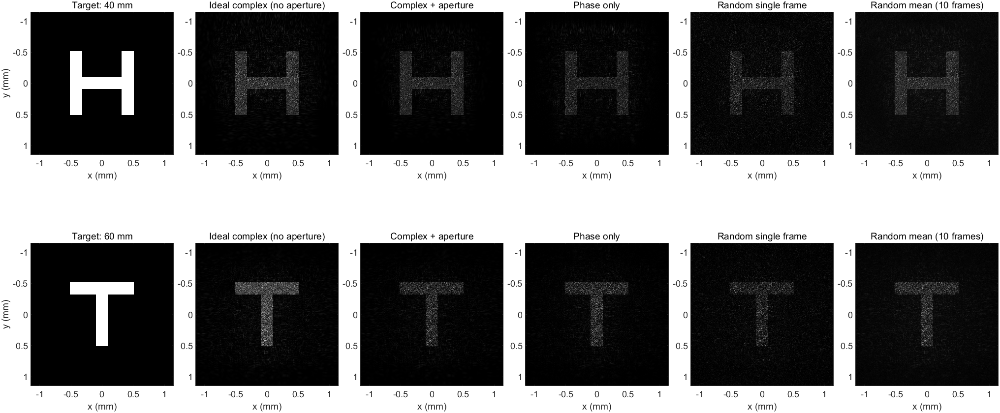
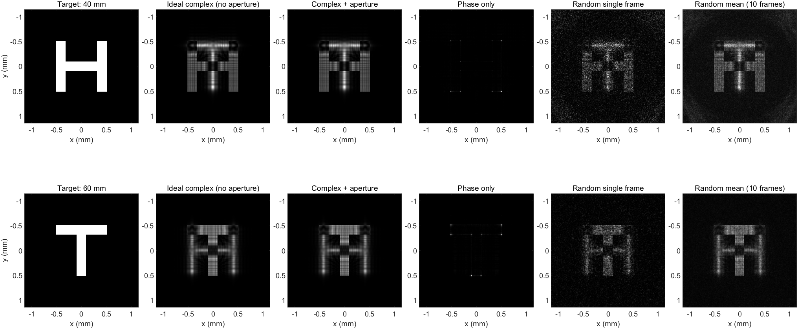

# 随机复振幅编码实现双平面全息重建

## 1. 研究目的与结论范围

本实验将随机复振幅编码用于双平面全息重建：先构造同时包含两个深度信息的复光场，再通过随机空间复用，将其编码为纯相位空间光调制器（SLM）可显示的相位图。目标为在距SLM 40 mm处重建H、60 mm处重建T。

当前仿真验证了方法的可行性，并体现出其在特定条件下保留振幅信息的优势：**零目标相位时，随机编码的图像形状误差低于直接取相位；随机目标相位时，本组参数下随机编码的误差仍高于直接取相位。** 因而不能据此宣称随机编码在双平面成像中普遍优于其他方法，也尚未完成与GS算法的同条件比较。

需要区分两种随机操作：

| 操作 | 所在阶段 | 作用 |
|---|---|---|
| 目标随机相位 | 构造目标复光场 | 改变离焦传播特性和SLM面光场分布 |
| 随机编码掩模 | 将复光场转换为纯相位 | 以振幅为概率，在目标相位与发散相位之间选择 |

## 2. 双平面复光场的构造

### 2.1 从目标强度得到目标复光场

设两个目标强度为 $I_H(x,y)$、$I_T(x,y)$，构造：

$$
U_j(x,y)=\sqrt{\frac{I_j(x,y)}{\sum_{x,y}I_j(x,y)}}\exp[i\alpha_j(x,y)],\qquad j\in\{H,T\}.
$$

归一化使两个目标具有相同的离散总能量，避免笔画面积差异引入初始能量偏置。所有像素面积相同，比较时省略共同的面积因子。

- 零目标相位：$\alpha_j=0$。
- 随机目标相位：亮像素上的 $\alpha_j$ 独立均匀分布于 $[0,2\pi)$。

两种选择在目标面具有相同强度，但传播到其他位置后的光场不同。

### 2.2 角谱传播

定义传播算子：

$$
\mathcal P_z[U]=\mathcal F^{-1}\{\mathcal F[U]H_z\},
\qquad
H_z(f_x,f_y)=\exp\left[i2\pi z\sqrt{\lambda^{-2}-f_x^2-f_y^2}\right].
$$

当前采样范围内仅包含传播波，因而 $H_{-z}=H_z^*$。MATLAB中使用未移位的 `fft2` 结果时，要用 `ifftshift` 将居中构造的传播因子调整为相同频率排列。

### 2.3 反向传播与复场叠加

$$
V_H=\mathcal P_{-z_H}[U_H],\qquad V_T=\mathcal P_{-z_T}[U_T],
$$

$$
\boxed{V=w_HV_H+w_TV_T.}
$$

权重作用于复振幅；本实验取 $w_H=w_T=1$。这里必须进行复数相加，不能将两张相位图直接相加。

理想情况下，传播到任意位置得到：

$$
\mathcal P_z[V]=w_H\mathcal P_{z-z_H}[U_H]+w_T\mathcal P_{z-z_T}[U_T].
$$

例如在H平面：

$$
\mathcal P_{z_H}[V]=w_HU_H+w_T\mathcal P_{z_H-z_T}[U_T].
$$

第二项是另一层的离焦光场，并不会自动消失。测量强度还包含两项之间的相干干涉。因此，直接复场叠加不保证两个平面都严格满足目标强度，随机编码也不会自动修复已有的层间串扰。

## 3. 有限孔径与振幅归一化

设均匀照明孔径为 $P(x,y)$，有效区域内为1，外围为0。定义：

$$
A_{\max}=\max_{P=1}|V|,\qquad
T=P\frac{V}{A_{\max}}=A\exp(i\varphi),
$$

$$
A=P\frac{|V|}{A_{\max}},\qquad \varphi=\arg V.
$$

于是 $0\le A\le1$，可以作为选择概率。整体常数缩放不改变相对复场结构；孔径截断则会丢失外围信息。孔径外无光是照明假设，不能由纯相位灰度图实现遮光。

孔径保留率定义为：

$$
\eta_{\mathrm{ap}}=\frac{\sum_{P=1}|V|^2}{\sum|V|^2}.
$$

本实验随机目标相位约为86.0%，零目标相位约为99.7%。该数值是设计复场的能量保留率，不是最终成像效率。

## 4. 随机复振幅编码：核心算法

### 4.1 两个候选纯相位函数

目标相位函数：

$$
F=\exp(i\varphi).
$$

用于引走多余光的发散函数：

$$
D=\exp(i\psi),\qquad
\psi=\operatorname{mod}\left(2\pi f_a\sqrt{x^2+y^2},2\pi\right).
$$

该径向线性相位相当于发散轴锥元件。在本脚本的传播符号约定下，正径向相位梯度对应向外的横向波矢。其空间频率须满足采样限制，光是否避开两个目标区域仍需通过传播计算检验。

### 4.2 按振幅概率逐像素选择

生成独立均匀随机数 $r(x,y)\in[0,1)$，定义二值掩模：

$$
R(x,y)=\begin{cases}1,&r(x,y)<A(x,y),\\0,&r(x,y)\ge A(x,y).\end{cases}
$$

最终相位为：

$$
\boxed{\theta(x,y)=\begin{cases}\varphi(x,y),&R=1,\\\psi(x,y),&R=0.\end{cases}}
$$

SLM出射光场为：

$$
\boxed{M=P\left[RF+(1-R)D\right].}
$$

有效区域内始终有 $|M|=1$，符合纯相位约束。这里不是相位插值，也不是让单个像素部分透光，而是对两个相位值进行二选一。

阈值使用SLM面归一化振幅 $A$，不能替换为 $A^2$，也不能直接使用目标图片强度。

### 4.3 统计原理与误差来源

对于均匀随机阈值：

$$
\Pr(R=1)=A,\qquad \mathbb E[R]=A.
$$

在有效区域内：

$$
\boxed{\mathbb E[M]=Ae^{i\varphi}+(1-A)D.}
$$

第一项正是所需复场，第二项通过发散相位向外围传播。令 $N_R=R-A$，单次编码可准确分解为：

$$
M=T+(1-A)D+N_R(F-D),\qquad (P=1).
$$

因此重建包含目标项、发散项及随机误差项。该统计等式并不意味着一张有限像素相位图能够无误差实现任意复场。

## 5. 多帧强度平均

固定目标复场、孔径及发散相位，生成 $K$ 张独立编码掩模。分别传播后，对强度进行平均：

$$
\overline I_j=\frac1K\sum_{k=1}^{K}\left|\mathcal P_{z_j}[M_k]\right|^2.
$$

实验上对应依次显示多张全息图并由相机积分。不能用平均相位代替，也不能把平均复光场的模平方当作平均强度。若传播场写成 $\overline U+\delta U$，且 $\mathbb E[\delta U]=0$，则：

$$
\mathbb E[|U|^2]=|\overline U|^2+\mathbb E[|\delta U|^2].
$$

可见增加帧数能减轻随机起伏，但噪声平均背景和固定层间串扰不一定消失。本实验只改变编码掩模，不改变目标相位；10帧结果也意味着额外的显示与积分时间。

## 6. MATLAB实现要点

以下为核心片段，完整可运行程序见同目录 `random_two_depth_demo.m`。其中 `H_H`、`H_T` 是已经调整为FFT频率排列的传播因子，`pupil` 为照明孔径。

```matlab
% 1. 两个目标反传到同一SLM面，并叠加完整复场
V_H = ifft2(fft2(U_H).*conj(H_H));
V_T = ifft2(fft2(U_T).*conj(H_T));
V = w_H*V_H + w_T*V_T;

% 2. 孔径限制与振幅归一化
Amax = max(abs(V(pupil==1)));
A = pupil.*abs(V)/Amax;
phi = angle(V);

% 3. 发散相位与随机选择
psi = mod(2*pi*f_a*hypot(X,Y),2*pi);
R = rand(size(A)) < A;
M = pupil.*(R.*exp(1i*phi)+(1-R).*exp(1i*psi));
theta = mod(angle(M),2*pi);

% 4. 同一张出射光场在两个深度重建
I_H_rec = abs(ifft2(fft2(M).*H_H)).^2;
I_T_rec = abs(ifft2(fft2(M).*H_T)).^2;
```

编码阶段仅需随机数比较和相位选择，不需要GS式迭代；完整计算还包括目标反传和重建所需的FFT。本次没有对计算速度进行计时比较。

## 7. 仿真参数与评价指标

| 参数 | 数值 |
|---|---|
| 波长 | 633 nm |
| 像素间距 | 8 μm |
| 计算网格 | 1536×1536 |
| 均匀照明区域 | 中央512×512 |
| 目标 | H：40 mm；T：60 mm |
| 复场权重 | 1:1；目标先等能量归一化 |
| 轴锥空间频率 | 40000 cycles/m |
| 编码帧数 | 1帧与10帧平均 |
| 随机数种子 | 7 |
| 评价区域 | 横纵坐标均在±1.15 mm内 |

两种目标相位模式消耗相同数量的目标随机数，使后续编码使用相同的随机数序列。改变目标相位仍会改变阈值 $A$ 和目标相位 $\varphi$，因此最终二值掩模并不相同。

ROI形状误差通过整体亮度拟合排除绝对亮度差异：

$$
s=\frac{\langle I,I_{\mathrm{target}}\rangle}{\langle I,I\rangle},\qquad
\epsilon_{\mathrm{ROI}}=\frac{\|sI-I_{\mathrm{target}}\|_2}{\|I_{\mathrm{target}}\|_2}.
$$

这里各向量均限制在ROI内，误差越小越好。该指标不是论文原始SNR，也不等于衍射效率。

目标区域能量比例为：

$$
\eta_{\mathrm{target}}=\frac{\sum_{I_{\mathrm{target}}>0}I}{\sum_{\mathrm{全部计算区域}}I}.
$$

两个深度是同一束光经过的不同截面，两个比例不应相加为总效率。该指标也不区分笔画内的有用光与串扰光。

## 8. 实测仿真结果

以下数据来自2026年10月7日保存的MATLAB输出，均为数值仿真结果，不是SLM光学实验测量。

### 8.1 ROI相对形状误差

| 方法 | 随机目标相位：H | 随机目标相位：T | 零目标相位：H | 零目标相位：T |
|---|---:|---:|---:|---:|
| 理想复场，无孔径截断 | 0.5463 | 0.4914 | 0.7855 | 0.7432 |
| 复场加孔径 | 0.5300 | 0.6699 | 0.7856 | 0.7457 |
| 直接取相位 | 0.6184 | 0.6800 | 0.9899 | 0.9843 |
| 随机编码单帧 | 0.7717 | 0.7922 | 0.8750 | 0.8076 |
| 随机编码10帧平均 | 0.6614 | 0.7251 | 0.8279 | 0.7628 |

零目标相位条件下，相比直接取相位，随机编码单帧在H/T平面的误差分别下降约11.6%/18.0%，10帧平均分别下降约16.4%/22.5%。但是随机目标相位条件下，随机编码单帧及平均结果均未超过直接取相位。

### 8.2 目标区域能量比例

| 方法 | 随机目标相位：H / T | 零目标相位：H / T |
|---|---:|---:|
| 直接取相位 | 50.92% / 43.27% | 24.83% / 34.35% |
| 随机编码单帧 | 5.44% / 3.64% | 1.41% / 1.08% |
| 随机编码10帧平均 | 5.45% / 3.62% | 1.39% / 1.07% |

随机编码改善特定条件下的形状保真度，同时将大量能量引向外围，存在明显的能量利用代价。对比图对不同方法分别设定显示亮度范围，不能直接据视觉亮度比较实际效率。

### 8.3 重建图

随机目标相位：



零目标相位：



每张图从左到右依次为目标、理想复场、孔径限制后的复场、直接取相位、随机编码单帧、10帧强度平均。上行为40 mm，下行为60 mm。同一方法的两个深度共用显示亮度上限。

两组传播往返误差均在 $10^{-15}$ 量级以内，纯相位约束及离散传播能量守恒检查通过。这些检查验证程序内部一致性，不代替真实器件实验或全面的采样收敛分析。

## 9. 可用于实验报告的结论

本实验利用角谱反向传播与复光场叠加构造双平面全息图，并通过振幅控制的随机空间复用，将复振幅信息编码到纯相位分布中。数值结果表明，在零目标相位条件下，与直接舍弃振幅相比，随机编码能够更好地保留重建图像的形状信息；多帧强度平均进一步降低了随机编码造成的图像误差。这说明振幅信息对于本例双平面重建具有实际作用，并验证了随机编码作为非迭代复振幅编码方案的可行性。

同时，实验显示算法效果依赖目标相位和光场设计。引入随机目标相位后，本例的层间区分和形状误差有所改善，但随机编码未优于直接取相位；随机编码还付出了目标区域能量比例下降的代价。因此，本实验支持的是特定条件下的保真度优势，而非普遍性能优势。后续可进一步优化目标相位、层间距和发散参数，并在相同孔径、目标、评价区域和曝光条件下与双平面GS比较。

## 10. 依据与文件

- 原论文：José Luis Martínez Fuentes and Ignacio Moreno, “Random technique to encode complex valued holograms with on axis reconstruction onto phase-only displays,” *Optics Express* 26, 5875–5893 (2018). DOI: [10.1364/OE.26.005875](https://doi.org/10.1364/OE.26.005875)。本文的随机编码原理来自该文；H/T双深度复场叠加与本报告中的对照属于本次仿真实现，不能作为原论文已经验证的双深度结果。
- 完整脚本：[random_two_depth_demo.m](../src/random_two_depth_demo.m)。
- 随机目标相位数据：[metrics.csv](../examples/random_phase/metrics.csv)。
- 零目标相位数据：[metrics.csv](../examples/zero_phase/metrics.csv)。
- 两个结果目录中的 `simulation.mat` 保存相应参数、相位和重建数据。导出的 `phase_active_8bit.png` 仅为有效区域的仿真相位映射；上机仍需匹配SLM相位标定与照明条件。
